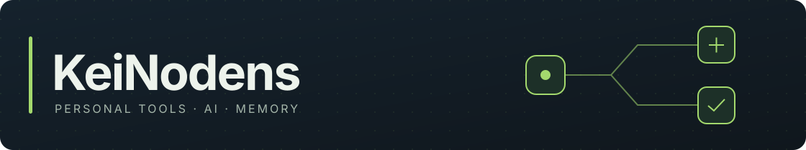

自分が使いたい道具を、AIと一緒に作っています。

最近は、会話を覚えて作業も手伝ってくれる相棒と、Minecraftの環境づくりを支援するツールに取り組んでいます。

## いま作っているもの

### [companion](https://github.com/KeiNodens/AIcompanion)

人格と長期記憶を持つ、日本語AIコンパニオン。開発者本人のローカル環境で運用しています。

- Discordやブラウザでの会話、タスク、リマインダー
- 会話の文脈を引き継ぐ、ローカルの記憶
- Hermes・Codexへの作業依頼、承認、成果の受け取り

会話中にHermesのツールを使えるよう、ツールの実行結果を受け取って同じ会話を再開する仕組みも作っています。

**Python · SQLite · MCP**

[概要・導入](https://github.com/KeiNodens/AIcompanion#readme) · [コード](https://github.com/KeiNodens/AIcompanion/tree/main/companion) · [テスト結果](https://github.com/KeiNodens/AIcompanion/actions)

---

### 次に作りたいもの：Prism LauncherのAI連携

MinecraftのMod導入、日本語化、不具合への対処を、日本語の会話から進めるツールを構想しています。Prism Launcherを通じた導入と、変更前の確認・失敗時の復旧まで扱いたいと考えています。

*構想・要件整理中。*

---

関心：AIの長期記憶、エージェント連携、Minecraft。

質問や提案は、[companionのIssues](https://github.com/KeiNodens/AIcompanion/issues)へどうぞ。
